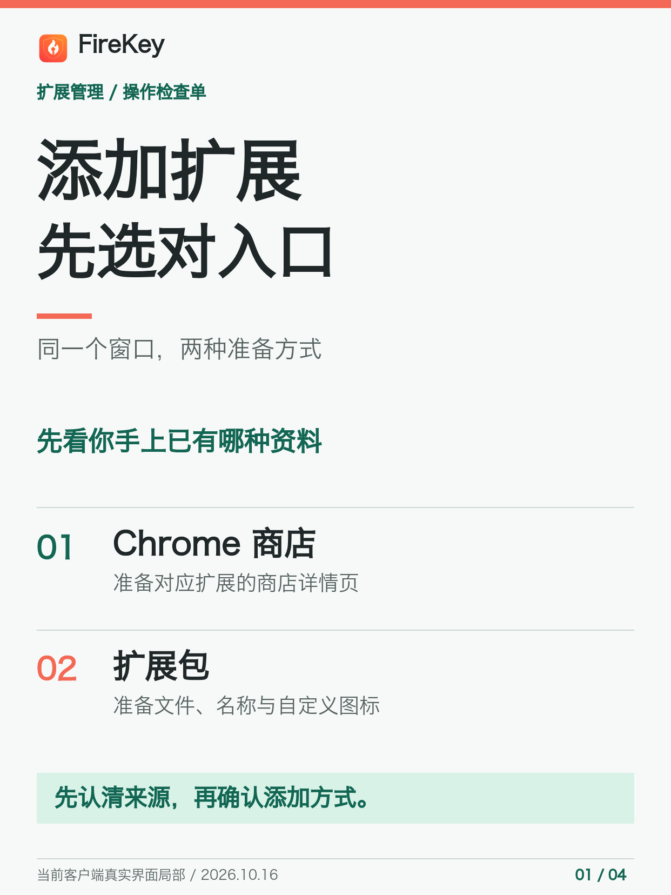
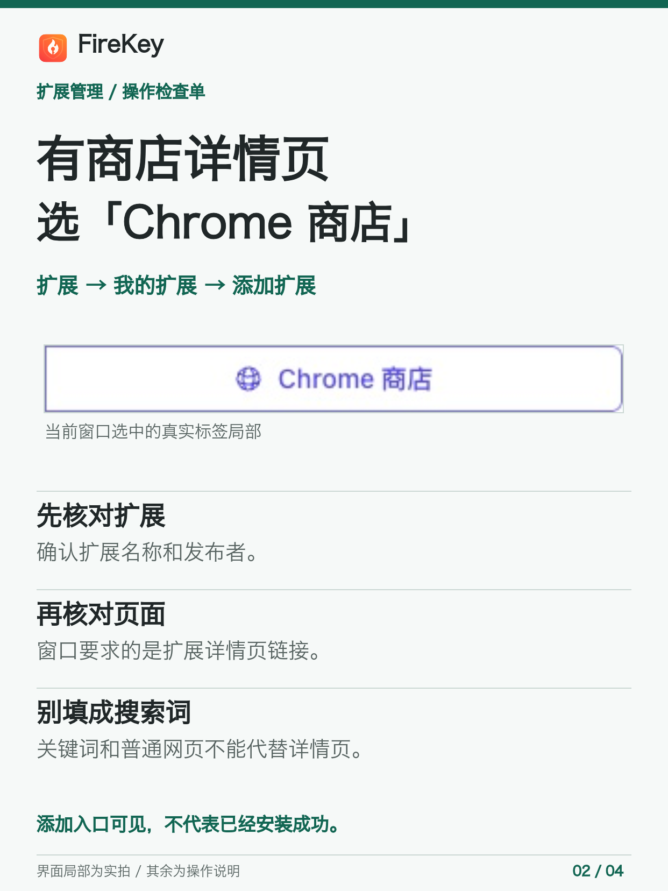
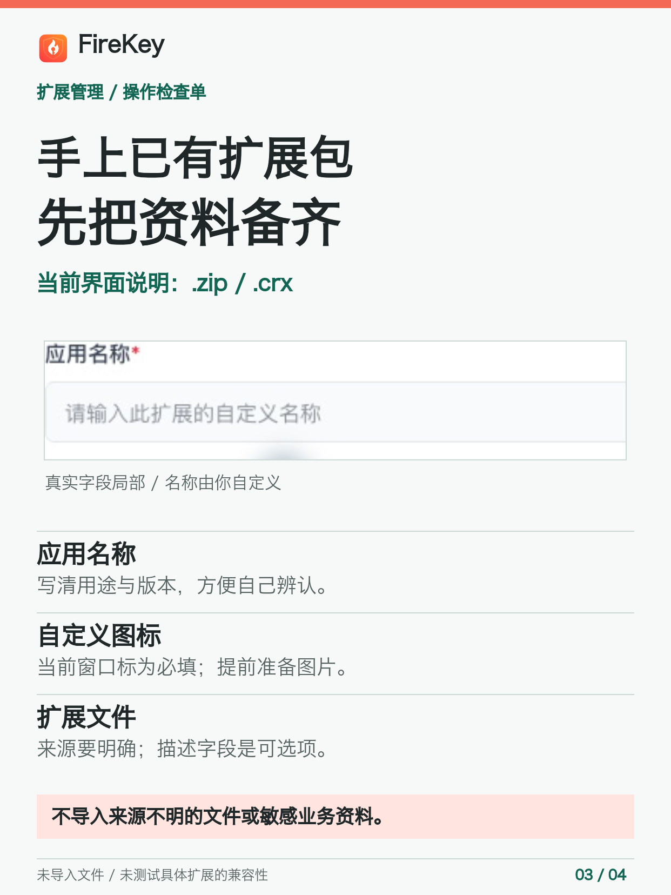
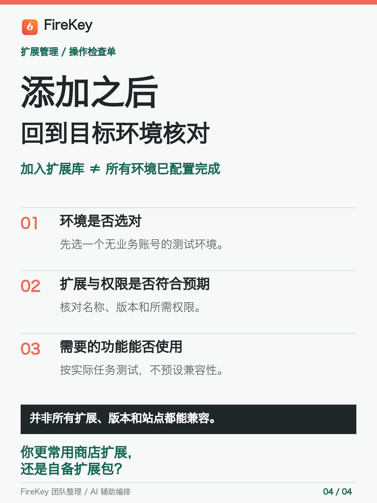

# Add extensions in FireKey: store URL or local package?

By the FireKey team. AI-assisted drafting and layout. The input fields described here were checked in the desktop app on October 26, 2026. The Chinese visual checklist uses redacted interface fragments captured on October 16, 2026; the original capture date is retained.

FireKey is a browser fingerprint and profile-management product. This guide covers one desktop task: choosing the right **Add extension** input for a test profile. It does not claim that the MCP server installs extensions or that every extension is compatible.

## Choose the input you actually have

In the Chinese desktop UI, open **Extensions > My extensions > Add extension** (`扩展 > 我的扩展 > 添加扩展`).

| What you have | Tab | Prepare before adding |
| --- | --- | --- |
| A Chrome Web Store extension detail page | `Chrome 商店` | The detail-page URL for that specific extension; check its name and publisher first. |
| An extension package you are authorized to use | `扩展包` | A file from a known source, an application name and a custom icon; the description is optional. |

The store field expects an extension detail-page URL, not a search phrase, search-results page or an arbitrary website address. Do not enter credentials into it.

The package instructions explicitly mention `.zip` and `.crx`. The file selector also lists `.nex`, so these two examples are **not an exhaustive format list**. A format appearing in a selector is not a compatibility test. Use the current client as the reference for accepted files and limits.

The application-name and custom-icon fields are marked required. A descriptive name such as `qa-helper-version` makes a package easier to identify later. Review its origin and requested permissions before using it; do not import files of unknown provenance or production account data for this check.

## Check one test profile before expanding the setup

Adding an item to the extension library is not evidence that every profile has been configured.

1. Choose one test profile without business accounts or sensitive data. If you have not created and started one yet, use the [first-profile guide](first-profile-test.md) first.
2. Check that you are working with the intended profile and its actual extension configuration. Do not assume a library entry means automatic application everywhere.
3. In that profile, verify the extension's name, version and permissions against your intended task.
4. Check whether the required function works on a page you own or are authorized to test. Record the result for that specific extension, version and profile.
5. Stop the test profile when finished. Do not expand the setup on the strength of a library entry alone.

This tutorial rechecked the entry points and fields only. We did **not** import a package, install an extension or run a compatibility test for this article. It does not promise a particular extension, version or third-party site will work, and it does not override a site's rules.

## If you get stuck

Use the existing [first-profile setup help thread](https://github.com/partnerhbhl/firekey-mcp/issues/1) for the initial create/start step. For an extension-specific problem, open a relevant issue in this repository with only:

- Your operating system and FireKey client version.
- The stage that failed: finding the tab, validating the input, adding the item or checking it in the target profile.
- A short, non-sensitive error message and what you expected.

Do not post passwords, verification codes, cookies, API keys, proxy credentials, private extension packages or live automation endpoints. Redact account and business areas in screenshots. A support question is not evidence of a completed signup or a successful first start.

If you have not installed FireKey, use the [official download page](https://www.firekey.ai/zh-cn/download). At this review it lists Windows 10+ and macOS 11.0+ builds; this guide does not establish a Linux installation path or promise any plan or trial allowance. Complete account registration and any verification privately yourself.

## 中文四页图解

添加扩展时，先看手上已有的是商店详情页还是自备扩展包。商店入口使用对应扩展的详情页；扩展包入口先准备来源明确的文件、应用名称和自定义图标，描述可选。添加后仍要核对目标测试环境、权限和具体功能，不把“加入扩展库”当成“所有环境均已配置完成”。

四页图解只含脱敏界面局部和操作说明，不是模拟产品界面。原截图拍摄于 2026 年 10 月 16 日，相关入口和字段已于 10 月 26 日重新核对；没有安装或兼容性测试。

## Verification scope and sources

- Primary workflow evidence: the installed desktop client's Add extension tabs and required fields, checked October 26, 2026. No private source screenshots are included in this repository.
- [Official feature overview](https://www.firekey.ai/zh-cn/features): product category and extension-management context only, not its unverified security or outcome marketing claims.
- [Official downloads](https://www.firekey.ai/zh-cn/download): currently listed desktop operating systems.
- [MCP server README](../README.md): profile lifecycle and the boundary between this server and page or extension interaction.
